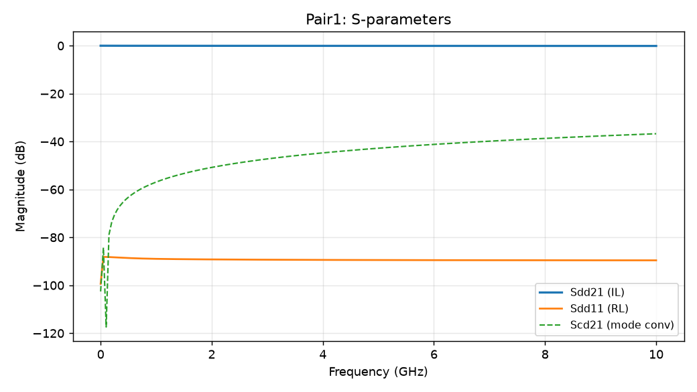

# S-Parameter Analysis Report — run_session

> 生成时间由程序确定。数值由确定性代码生成，AI 仅生成解释。
> 路线图 §13.3：计算结果与 AI 建议明确分离。

## 0. 模型概览


> 图 0：Pair1 设计 3D 模型预览（求解前）。

## 1. 任务摘要

- **任务 ID**：run_session
- **类型**：Touchstone / S 参数自动分析
- **通道**：Pair1
- **验收结果**：➖ NOT EVALUATED
- **输入文件**：`D:\HCX\HFSS\em-copilot\runs\twinaxial-demo-001\run_session\Twinaxial_cable_28AWG_sweep.s4p`
- **输入 SHA-256（前 16 位）**：`22297f3f736f0009`
- **频率范围**：0.000 Hz ~ 10.000 GHz
- **频率点数**：201

## 2. 输入文件与版本

- Touchstone 端口数：4
- 原始格式：MA
- 原始频率单位：ghz
- 参考阻抗 Z0：50.0 Ω
- 差分对：Pair1, Pair2

## 3. Preflight 检查

- ✅ 端口数、频率范围、单调性、数值有效性检查全部通过

## 4. S 参数结果



> 图 1：Pair1 通道 S 参数（Sdd21 插损 / Sdd11 回损 / Scd21 模式转换）。

### 4.1 最差情形（worst case）

| 指标 | 最差值 |
|---|---|
| Sdd11_dB_worst | -88.143 |
| Sdd21_dB_worst | -0.097 |
| Scd21_dB_worst | -36.742 |
| Sdc21_dB_worst | -36.742 |
| Sdd12_dB_worst | -0.097 |
| Scd12_dB_worst | -36.742 |
| Sdc12_dB_worst | -36.742 |
| worst_Sdd21_freq_hz | 10000000000.000 |

## 6. 指定频点结果

| frequency_hz | frequency_requested_hz | frequency_actual_hz | frequency_error_hz | frequency_in_tolerance | frequency_index | Sdd11_dB | Sdd22_dB | Scc11_dB | Sdd21_dB | Scc21_dB | Scd21_dB | Sdc21_dB | Sdd12_dB | Scc12_dB | Scd12_dB | Sdc12_dB | frequency |
|---|---|---|---|---|---|---|---|---|---|---|---|---|---|---|---|---|---|
| 1000000000.0000 | 1000000000.0000 | 1000000000.0000 | 0.0000 | True | 20 | -88.9578 | -89.0295 | -86.5978 | -0.0323 | -0.0323 | -56.8991 | -56.8967 | -0.0323 | -0.0323 | -56.8967 | -56.8991 | 1.000 GHz |
| 3000000000.0000 | 3000000000.0000 | 3000000000.0000 | 0.0000 | True | 60 | -89.3199 | -89.4408 | -86.6057 | -0.0491 | -0.0492 | -47.2435 | -47.2427 | -0.0491 | -0.0492 | -47.2427 | -47.2435 | 3.000 GHz |

## 7. 串扰

- 本通道仅含单差分对收发端口（near/far），无独立串扰对，NEXT/FEXT 不适用（需 ≥3 个差分端口才有独立串扰对）。

## 9. 验收规则

（未定义验收规则）

## 10. 可复现信息

```json
{
  "task_id": "run_session",
  "touchstone": "D:\\HCX\\HFSS\\em-copilot\\runs\\twinaxial-demo-001\\run_session\\Twinaxial_cable_28AWG_sweep.s4p",
  "pair": "Pair1",
  "compliance": "NOT_EVALUATED",
  "pass_fail": false,
  "worst_case": {
    "Sdd11_dB_worst": -88.14311113966656,
    "Sdd21_dB_worst": -0.09661042163573477,
    "Scd21_dB_worst": -36.74193855361258,
    "Sdc21_dB_worst": -36.74168971614338,
    "Sdd12_dB_worst": -0.09661042163572794,
    "Scd12_dB_worst": -36.74168971614437,
    "Sdc12_dB_worst": -36.741938553611554,
    "worst_Sdd21_freq_hz": 10000000000.0
  },
  "points_of_interest": [
    {
      "frequency_hz": 1000000000.0,
      "frequency_requested_hz": 1000000000.0,
      "frequency_actual_hz": 1000000000.0,
      "frequency_error_hz": 0.0,
      "frequency_in_tolerance": true,
      "frequency_index": 20,
      "Sdd11_dB": -88.95780576659081,
      "Sdd22_dB": -89.02948585767444,
      "Scc11_dB": -86.59779445629958,
      "Sdd21_dB": -0.0322505651292027,
      "Scc21_dB": -0.03229138432030345,
      "Scd21_dB": -56.89906424017061,
      "Sdc21_dB": -56.89673514601577,
      "Sdd12_dB": -0.032250565129102036,
      "Scc12_dB": -0.03229138432021246,
      "Scd12_dB": -56.896735265212655,
      "Sdc12_dB": -56.89906423148309,
      "frequency": "1.000 GHz"
    },
    {
      "frequency_hz": 3000000000.0,
      "frequency_requested_hz": 3000000000.0,
      "frequency_actual_hz": 3000000000.0,
      "frequency_error_hz": 0.0,
      "frequency_in_tolerance": true,
      "frequency_index": 60,
      "Sdd11_dB": -89.31989136503992,
      "Sdd22_dB": -89.44078647586338,
      "Scc11_dB": -86.60570921951448,
      "Sdd21_dB": -0.04905966412731161,
      "Scc21_dB": -0.04916337946093387,
      "Scd21_dB": -47.24353785743627,
      "Sdc21_dB": -47.24269230728459,
      "Sdd12_dB": -0.04905966412722822,
      "Scc12_dB": -0.04916337946083592,
      "Scd12_dB": -47.24269230928074,
      "Sdc12_dB": -47.24353786360038,
      "frequency": "3.000 GHz"
    }
  ],
  "acceptance": [],
  "warnings": [],
  "input_hash": "22297f3f736f0009",
  "n_freqs": 201,
  "freq_range_hz": [
    0.0,
    10000000000.0
  ]
}
```

- 结构化结果同时写入 `metrics.json`。
- 本报告中所有数值由 `em_copilot` 确定性代码生成，未经 AI 修改。
